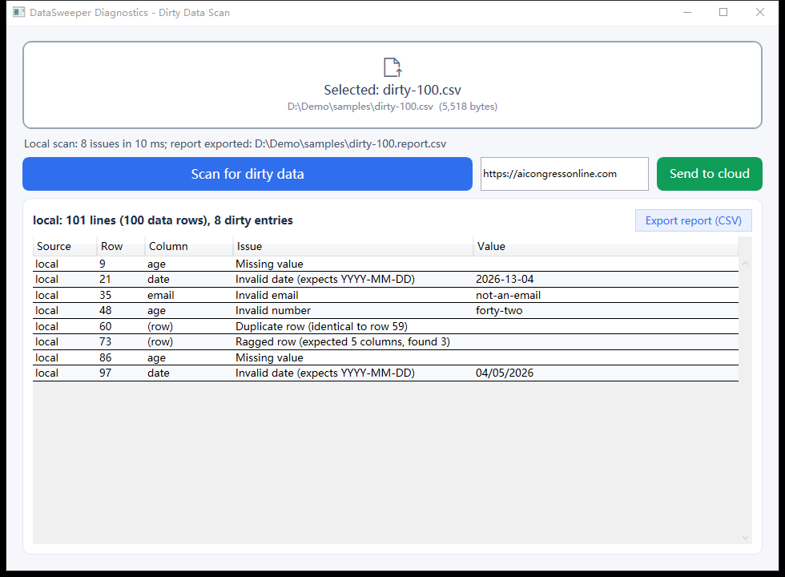
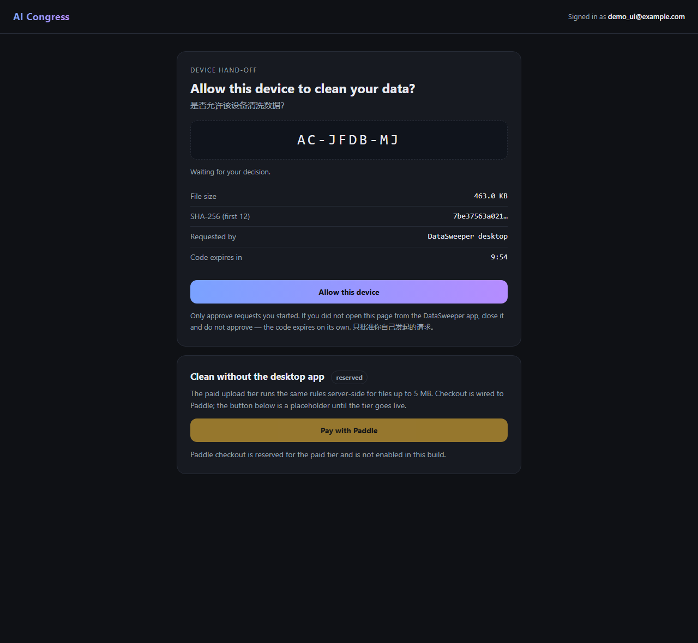

# DataSweeper Diagnostics

A small Windows desktop shell for finding dirty rows in tabular files before you load them anywhere else.

Drop a CSV on the window and it reports, row by row and column by column:

- missing values
- dates that do not match `YYYY-MM-DD`
- malformed e-mail addresses
- non-numeric values in numeric columns (`age`, `amount`, `qty`, `price`)
- ragged rows (column count differs from the header)
- duplicate rows



## Implementation

Our core is based on C# (.NET 8 WPF) for better UI and performance, with a
[multi-language benchmark report](BENCHMARK.md): the same cell-classification
pass implemented in five languages against a 50,000-row file, with the raw
output of every run published.

## Run it

Download `DataSweeper-v1.0.1-win-x64.zip` from the Releases page, unzip it anywhere, and start `DataSweeper.exe`.

Windows 10/11 x64. The build is self-contained: no .NET runtime install required.

You can also drop a file onto the window, or pass one on the command line:

```
DataSweeper.exe path\to\data.csv
```

The scan runs on a worker thread, the grid is virtualized so a 100,000-row file scrolls smoothly, and **Export report (CSV)** writes `Source,Row,Column,Issue,Value` with a UTF-8 BOM so Excel opens it correctly.

## Optional: clean on the server

The **Send to cloud** button hands the file to the AI Congress cleaning service:

1. The app hashes the file and asks the service for an 8-character hand-off code.
2. Your browser opens a page that asks whether to allow *this device* to clean the data.
3. Once you approve there, the app receives a 15-minute token scoped to that one upload, sends the file, and imports the result CSV back into the grid.



Cloud cleaning is the paid tier (3 USD through Gumroad). The approval page opens the
checkout, notices the purchase by itself once Gumroad confirms it, and hands the app a
15-minute cleaning token; the app sends that token with the upload. Without a purchase
the service answers `403 payment required`.

The token cannot be used for anything else, and it is bound to the exact bytes that were hashed when the code was issued. Nothing is uploaded unless you press the button, and the URL field is editable if you run your own instance.

## Build

Requires the .NET 8 SDK.

```
dotnet build -c Release
dotnet publish -c Release -r win-x64 --self-contained -p:PublishSingleFile=true
```

The published single file lands in `bin\Release\net8.0-windows\win-x64\publish\`.

## Sample

`samples/dirty-100.csv` is 100 synthetic rows with eight planted defects (one of each kind, plus a ragged row). Running the app on it should report exactly those rows.

## License

MIT — see [LICENSE](LICENSE).

Author: Sam Jin.
